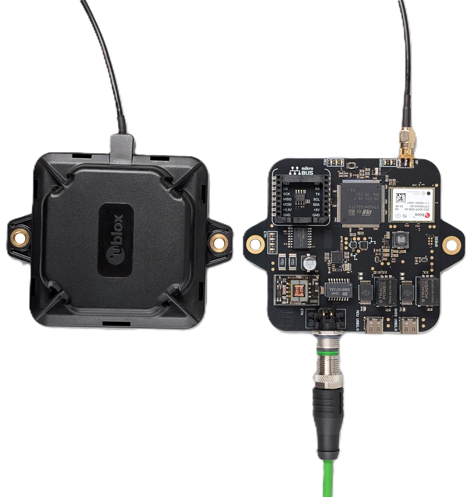

# Towards a Single Module High-Precision Self-Localization Node

Bachelor Thesis, Ciril Clerc — ETH Zürich, PBL / IIS, June 2026.

An all-in-one self-localization node built around the U-Blox ZED-X20P GNSS module,
an STM32H755 dual-core MCU, an IMU and an eCompass. It streams SPARTN corrections
from U-Blox PointPerfect Flex (PPP-RTK) over Ethernet/PoE, with automatic fallback to
Galileo HAS, achieving centimetre-level localization without a local base station.

## Repository Structure

- **[firmware/](firmware/)** — STM32H755 dual-core firmware (CM4: GNSS/sensor
  acquisition, CM7: networking/data aggregation) plus host-side Python scripts for
  logging and plotting. See [firmware/Readme.md](firmware/Readme.md) for the full
  architecture and pin reference.
- **[ublox_gnss_node/](ublox_gnss_node/)** — Altium Designer PCB project for the
  GNSS sensor node (schematics, layout, library, fabrication outputs).

